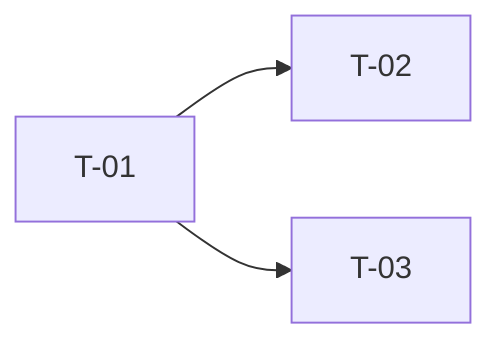

# 任务清单（tasks.md）：<项目/功能名称>

> 关联提案：`specs/NNN-<slug>/proposal.md`　|　关联设计：`design.md`
> 版本：v0.1　|　负责人：　|　更新日期：YYYY-MM-DD

<!--
使用说明：
1. 任务粒度 = 一个可验证的交付物 = 一次可提交的变更；"实现后台"这种粒度不合格。
2. 每条任务必须有：编号、标题、交付物、验收标准、依赖、预估；缺验收标准的任务不许进入执行。
3. 依赖关系画成第 2 节的依赖图；只有无共享文件的任务才能标为并行组。
4. 状态：TODO / DOING / DONE / BLOCKED（BLOCKED 必须写原因）。
-->

## 1. 任务清单

| 编号 | 任务 | 交付物 | 验收标准（可执行验证） | 依赖 | 预估 | 负责人 | 状态 |
|---|---|---|---|---|---|---|---|
| T-01 | 项目结构初始化 | 目录骨架、依赖清单、配置样例 | `uv sync` 成功；`python -m <pkg>` 可启动；CI 首次通过 | - | 2h |  | TODO |
| T-02 |  |  |  | T-01 |  |  | TODO |
| T-03 |  |  |  | T-01 |  |  | TODO |

<!-- 验收标准示例：
- 运行 `pytest tests/test_<module>.py` 全部通过
- 调用 <接口> 返回 200 且字段 <x> 非空
- 数据表 <t> 写入 1 条后查询可复现
-->

## 2. 执行顺序（依赖图）

<!-- 用 Mermaid 或 ASCII 绘制；不可存在环 -->

## 3. 并行组

<!-- 仅列出无共享文件、可并行的任务；共享文件（如编排入口、公共配置）必须串行 -->

| 并行组 | 任务 | 共享文件 | 备注 |
|---|---|---|---|
| - | - | 无 |  |

## 4. 范围覆盖核对

<!-- 每条 proposal 范围条目（R-xx）与成功标准（SC-xx）都要有任务承接，否则视为漏项 -->

| 范围条目 / 成功标准 | 承接任务 | 状态 |
|---|---|---|
| R-01 | T-0x | TODO |
| SC-01 | T-0x | TODO |

## 5. 完成标准

- [ ] 所有 P0 任务为 DONE
- [ ] 验收标准（SC-xx）逐条核对通过
- [ ] 单元测试与集成测试通过，静态扫描零告警
- [ ] 每个任务对应一次提交，提交信息带任务编号
- [ ] 规范（proposal/design/tasks）与代码一致，无未同步变更
- [ ] 文档（调研报告、分析报告、README）已更新

## 6. 备注

<!-- 阻塞原因、决策记录、遗留问题；阻塞项必须写清"卡在什么、谁推进、何时复评" -->
