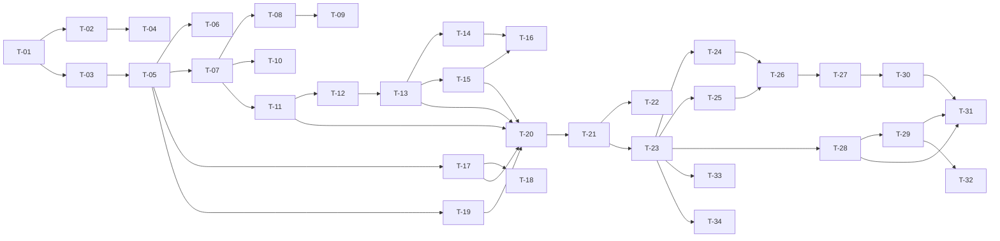

# 任务清单（tasks.md）：智能日报生成器 v1（MVP）

> 关联提案：`specs/001-daily-report-mvp/proposal.md`　|　关联设计：`design.md`
> 版本：v1.0　|　负责人：项目组　|　更新日期：2026-11-27

## 1. 任务清单

> 状态：TODO / DOING / DONE / BLOCKED。`DONE` 以仓库中的提交、测试或命令证据为准；仅代码写完但未验证的任务在「证据 / 备注」中注明验证边界。

| 编号 | 任务 | 交付物 | 验收标准（可执行验证） | 依赖 | 预估 | 负责人 | 状态 | 证据 / 备注 |
|---|---|---|---|---|---|---|---|---|
| T-01 | 项目骨架与工具链 | `pyproject.toml`、`src/daily_report/`、`.env.example`、`.github/workflows/ci.yml`、`CONTRIBUTING.md` | `uv sync --dev` 成功；`uv run python -m daily_report --help` 输出子命令；CI 首次通过 | - | 3h | 后端 | DONE | `12c1c07` |
| T-02 | 配置与日志基础 | `config.py`、`logging.py` | 缺少 `APP_SECRET_KEY` 时启动失败；环境变量可覆盖配置；日志中的令牌/邮箱被脱敏 | T-01 | 2h | 后端 | DONE | `4136dfc`、`1505e49`；`tests/test_config_logging.py` |
| T-03 | 数据模型与迁移 | `models.py`、`migrations/versions/daae5d4073a1_initial_schema.py` | `uv run alembic upgrade head` 成功；表结构与 `design.md` §3.2 一致；`(source, source_id)`、`(member_id, report_date)` 唯一约束生效 | T-01 | 4h | 后端 | DONE | `9c67c96`；`tests/test_db_models.py` |
| T-04 | HTTP 客户端、限流与重试 | `http.py` | 429 按 `Retry-After` 重试；超时重试；4xx 不重试；最多 3 次；令牌桶可等待 | T-02 | 3h | 后端 | DONE | `22e556d`；`tests/test_http.py` |
| T-05 | 仓储层与事务 | `repositories.py`、`db.py` | WAL / 外键 / `busy_timeout` 生效；事件 upsert 幂等；日报条目可替换；推送记录唯一；流水线运行可记录 | T-03 | 4h | 后端 | DONE | `a3b0143`；`tests/test_repositories.py` |
| T-06 | 错误模型与审计服务 | `errors.py`、`audit.py` | 错误码稳定；敏感键被过滤；审计只存元数据，不含正文与令牌 | T-05 | 2h | 后端 | DONE | `fad21f2`；`tests/test_errors_audit.py` |
| T-07 | Collector 协议与 Mock 采集器 | `collectors/base.py`、`collectors/mock.py` | `collect_all` 并发上限 3；单源异常被隔离并写入 `errors`；Mock 四源各返回 1 条事件 | T-05 | 3h | 后端 | DONE | `242c0f3`；`tests/test_collectors_base.py` |
| T-08 | 飞书日历与云文档采集 | `collectors/feishu.py` | 日程解析出参会人；文档只取元数据并按时间窗过滤；401 映射为 `E-COL-001` | T-07 | 4h | 后端 | DONE | `316186a`；`tests/test_collectors_feishu.py` |
| T-09 | 飞书任务采集 | `collectors/feishu.py` | 任务状态变更解析为 `task_update`；只读，不修改任务 | T-08 | 2h | 后端 | DONE | `316186a`；`tests/test_collectors_feishu.py` |
| T-10 | GitHub commit / PR 采集 | `collectors/github.py` | 只保留成员本人 commit；PR 作者匹配；ETag 304 跳过；401 抛错；`GITHUB_LOGIN` 显式匹配 | T-07 | 5h | 后端 | DONE | `070aa1b`、`842861c`；`tests/test_collectors_github.py` |
| T-11 | 聚合与去重 | `generation/aggregator.py` | 按 `(source, source_id)` 去重；窗口外事件丢弃；按发生时间排序 | T-07 | 2h | 后端 | DONE | `b065588`；`tests/test_generation.py` |
| T-12 | 协作归属与置信度分级 | `generation/attribution.py` | 置信度 ≥0.9 为 auto；0.5–0.9 为 pending；<0.5 为 dropped；保留角色与来源 | T-11 | 2h | 后端 | DONE | `b065588`；`tests/test_generation.py` |
| T-13 | 四段式草稿构建 | `generation/builder.py` | 固定四段；阻塞/逾期任务进入「风险与阻塞」；dropped 不进入草稿；每条带来源 ID | T-12 | 3h | 后端 | DONE | `b065588`；`tests/test_generation.py` |
| T-14 | LLM Provider 与降级 | `generation/llm.py` | `LLMProvider` 协议、DeepSeek 实现、FakeProvider 与缓存；超时/非法 JSON 时降级且不阻断 | T-13 | 4h | 后端 | DONE | `b065588`；`tests/test_generation.py`、`tests/test_faults.py` |
| T-15 | Schema 与来源校验 | `generation/validator.py` | 未知段落、空内容、无来源、非法置信度被剔除或记录错误 | T-13 | 2h | 后端 | DONE | `b065588`；`tests/test_generation.py` |
| T-16 | 生成层测试 | `tests/test_generation.py` | 聚合、归属、草稿、降级、校验、缓存、DeepSeek 调用全部有断言且通过 | T-14、T-15 | 3h | 测试 | DONE | `b065588` |
| T-17 | 推送协议与飞书推送 | `publishers/base.py`、`publishers/feishu.py` | 卡片消息发送成功；401/403 映射错误码；同幂等键不重复发送；失败可重试 | T-05 | 4h | 后端 | DONE | `b9a0507`；`tests/test_publishers.py` |
| T-18 | 邮件推送预留 | `publishers/email.py` | 未配置 SMTP 返回 `E-PUSH-010`；配置后通过 SMTP 发送 | T-17 | 2h | 后端 | DONE | `b9a0507`；`tests/test_publishers.py`；未接入 `build_service`（P2） |
| T-19 | 团队汇总 | `rollup.py` | 只聚合 `submitted/pushed`；未提交成员显示「未提交」；内容不含排名 | T-05 | 3h | 后端 | DONE | `84f5088`；`tests/test_pipeline.py` |
| T-20 | 单成员流水线 | `pipeline.py` | 采集 → 生成 → 校验 → 落库 → 推送；`run_key` 幂等返回 `skipped`；失败写 `pipeline_run(failed)` | T-11～T-17、T-19 | 5h | 后端 | DONE | `5ac455b`；`tests/test_pipeline.py` |
| T-21 | 全员流水线与失败隔离 | `pipeline.py` | 逐成员执行；单成员失败不影响其他成员；整体状态为 `partial` | T-20 | 3h | 后端 | DONE | `5ac455b`；`tests/test_pipeline.py` |
| T-22 | Celery 定时任务 | `celery_app.py` | Beat 配置为工作日 17:30 生成、17:45 汇总，时间可由环境变量覆盖；任务名可被 Worker 发现 | T-21 | 3h | 后端 | DONE（配置级） | `4836ac3`；Worker/Beat 端到端未在 CI 验证（无 Redis 服务），由 T-31 补记录 |
| T-23 | API、权限与服务装配 | `api.py`、`service.py`、`auth.py` | 健康检查、登录、本人日报读写、生成、提交、推送、团队汇总可用；401/403/409 行为符合契约 | T-20、T-21 | 6h | 后端 | DONE | `fb2872e`；`tests/test_api.py` |
| T-24 | 全链路集成测试 | `tests/test_pipeline.py`、`tests/conftest.py` | Mock 流水线产出日报、条目、推送记录；重复执行幂等；全员流水线通过 | T-23 | 4h | 测试 | DONE | `d02600a`；2026-11-27 `pytest -q`：73 passed |
| T-25 | 故障注入测试 | `tests/test_faults.py`、`tests/test_http.py` | 单源 401、空数据、模型失败、推送失败、重复推送、429/超时均有断言 | T-23 | 4h | 测试 | DONE | `d02600a`；与 `docs/验收核对表.md` §3 场景对应 |
| T-26 | 质量门禁与 CI 收口 | `.github/workflows/ci.yml` | `ruff check .` 零告警；`mypy src` 零错误；`pytest -q` 全绿；密钥扫描通过 | T-24、T-25 | 2h | 后端 | DONE | 2026-11-27 本地：ruff 通过、mypy 33 files 无问题、pytest 73 passed |
| T-27 | 演示脚本与验收核对表 | `docs/演示脚本.md`、`docs/验收核对表.md` | README / 演示脚本中的 Mock 命令可复现；核对表列出 SC 与故障场景 | T-26 | 3h | 文档 | DONE | `8bd35c7` |
| T-28 | Vue 3 管理端 | `web/src/views/LoginView.vue`、`ReportView.vue`、`TeamView.vue`、`web/src/api/` | `cd web && npm run build` 成功；登录、我的日报、团队汇总页面可访问 | T-23 | 8h | 前端 | DONE | `2ad7c39`；2026-11-27 `npm run build` 成功（vite 6.4.6） |
| T-29 | 飞书 OAuth 登录与前端授权跳转 | `api.py`、`feishu_api.py`、`web/src/views/LoginView.vue` | 登录 URL 包含 `redirect_uri`；回调用 code 换取用户信息并跳回前端；scope 不足时错误含提示；Mock 下可直接登录 | T-23、T-28 | 5h | 后端 / 前端 | DONE | `9995e10`、`0a85b1d`；`tests/test_api.py`、`tests/test_feishu_oauth.py` |
| T-30 | 验收测试代理 | `docs/验收测试代理.md`、`.claude/agents/acceptance-tester.md` | 代理只读源码、执行门禁与 Mock 全链路、按证据回填核对表，禁止编造结论 | T-27 | 2h | 测试 | DONE | `faf3c1f` |
| T-31 | 执行验收并回填核对表 | `docs/验收核对表.md` 结果列与结论 | 按代理流程执行 `ruff/mypy/pytest`、Mock 全链路、故障场景、Alembic；每条填「通过/不通过/N/A（原因）」并附证据 | T-27、T-28、T-29、T-30 | 4h | 测试 | TODO | 当前核对表结果均为「待验证」；执行后更新版本与日期 |
| T-32 | 真实凭证联调 | `.env` 本地配置（不入库）、真实飞书 / GitHub / DeepSeek 适配器 | 用真实凭证跑通一次「采集 → 生成 → 推送」；日志无令牌与正文；失败项有错误码 | T-29 | 8h | 后端 | BLOCKED | 卡在飞书应用 scope/审批、GitHub PAT、DeepSeek Key（O-01/O-02）；解除后执行 |
| T-33 | 待确认条目提交校验（条件任务） | `api.py` 提交接口与相关测试 | 草稿存在 `confirmed=false` 条目时，提交返回 409 或要求先确认；确认后可提交 | T-23 | 3h | 后端 | TODO | 来自 H-02/Q-04；是否纳入本期由 O-03 决定，评审通过后实施 |
| T-34 | 规格与实现同步 | `design.md` §4.5 接口清单、追溯关系 | 接口清单包含 `/api/health`、`/api/me`、`/api/oauth/feishu/login-url`、`/api/reports/{date}/generate`；R-xx 与模块对应关系可查 | T-23 | 1h | 架构师 | TODO | 当前实现已提供上述接口，但设计文档未登记（O-08） |

## 2. 执行顺序（依赖图）



## 3. 并行组

| 并行组 | 任务 | 共享文件 | 备注 |
|---|---|---|---|
| A | T-08、T-10 | 无 | T-08 与 T-09 共用 `collectors/feishu.py`，必须串行；T-10 可并行 |
| B | T-14、T-15 | 无 | 分别修改 `llm.py` 与 `validator.py` |
| C | T-17、T-19 | 无 | T-18 依赖 `publishers/base.py`，需在 T-17 之后 |
| D | T-24、T-25、T-28 | 无 | 测试文件与 `web/` 互不重叠；T-29 依赖 T-28 的 `LoginView.vue`，需串行 |
| E | T-33、T-34 | 无 | T-33 改 `api.py`，与 T-29 串行；T-34 只改 `design.md` |

## 4. 范围覆盖核对

| 范围条目 / 成功标准 | 承接任务 | 状态 |
|---|---|---|
| R-01 飞书登录与成员建档 | T-23、T-29 | DONE |
| R-02 飞书日历采集 | T-08、T-20 | DONE |
| R-03 飞书云文档采集 | T-08、T-20 | DONE |
| R-04 飞书任务采集 | T-09、T-20 | DONE |
| R-05 聚合、去重与归属 | T-11、T-12、T-15 | DONE |
| R-06 AI 四段式生成与降级 | T-13、T-14、T-15 | DONE |
| R-07 草稿编辑、提交与版本 | T-23、T-28 | DONE |
| R-08 飞书推送与幂等 | T-17、T-20 | DONE |
| R-09 权限、审计与密钥 | T-06、T-23、T-26 | DONE |
| R-10 流水线幂等与调度 | T-20、T-21、T-22 | DONE（T-22 配置级） |
| R-11 GitHub 采集 | T-10 | DONE |
| R-12 团队汇总 | T-19、T-23、T-28 | DONE |
| SC-01 登录与建档 | T-23、T-29 | DONE |
| SC-02 三源采集 | T-08、T-09、T-24 | DONE |
| SC-03 GitHub 采集 | T-10、T-24 | DONE |
| SC-04 归属与四段生成 | T-11、T-12、T-13、T-15 | DONE |
| SC-05 编辑、提交与版本 | T-23、T-28、T-24 | DONE（409 分支为代码级，待 T-31 补测） |
| SC-06 推送与幂等 | T-17、T-25 | DONE |
| SC-07 流水线幂等与调度 | T-20、T-22 | DONE（T-22 配置级） |
| SC-08 团队汇总 | T-19、T-28 | DONE |
| SC-09 权限、审计与密钥 | T-06、T-23、T-26 | DONE |
| SC-10 单份生成 ≤5 秒 | T-31 | TODO |
| SC-11 确认 ≤2 步 | T-28、T-31 | TODO |
| SC-12 50 人 ≤3 分钟 | T-31 | TODO |
| SC-13 采集成功率 ≥95% | T-32 | BLOCKED |
| SC-14 超时与重试 | T-04、T-25 | DONE |
| SC-20 无数据 | T-25 | DONE |
| SC-21 单源 401 | T-25 | DONE |
| SC-22 429 / 超时 | T-04、T-25 | DONE |
| SC-23 模型降级 | T-14、T-25 | DONE |
| SC-24 推送失败 | T-17、T-25 | DONE |
| SC-25 重复触发 / 推送 | T-20、T-25 | DONE |
| SC-26 越权访问 | T-23、T-24 | DONE |
| SC-27 缺少密钥 | T-02 | DONE |
| SC-28 非草稿状态编辑 | T-23、T-31 | TODO（代码已实现，待补测试证据） |
| SC-29 飞书 scope 不足 | T-29 | DONE |

## 5. 完成标准

- [x] 功能任务 T-01～T-30 的交付物已提交；T-31～T-34 为验收、联调、条件任务与规格同步
- [x] 单元/集成测试通过：2026-11-27 执行 `pytest -q` 为 73 passed
- [x] 静态检查通过：`ruff check .` 零告警；`mypy src` 无错误（33 个源文件）
- [x] 前端生产构建通过：`cd web && npm run build` 成功
- [ ] 性能指标 SC-10～SC-13 完成测量并记录（T-31 / T-32）
- [ ] `docs/验收核对表.md` 全部条目回填「通过 / 不通过 / N/A」并附证据（T-31）
- [ ] 真实飞书 / GitHub / DeepSeek 凭证联调通过（T-32）
- [ ] `design.md` 接口清单与实现一致（T-34）
- [x] README、演示脚本、验收核对表、验收测试代理文档已更新

## 6. 备注

### 6.1 2026-11-27 验证记录

```text
uv run ruff check .   → All checks passed!
uv run mypy src       → Success: no issues found in 33 source files
uv run pytest -q      → 73 passed, 1 warning
cd web && npm run build → built in 6.58s（vite 6.4.6）
```

### 6.2 已知差异与遗留项

1. **待确认条目提交拦截**：`api.py` 的提交接口只校验状态与归属，未强制拦截 `confirmed=false` 的条目；需求澄清 H-02/Q-04 要求「未确认不写入日报」。是否本期实施由 O-03 决定，对应条件任务 T-33。
2. **设计接口清单滞后**：`design.md` §4.5 未登记 `/api/health`、`/api/me`、`/api/oauth/feishu/login-url`、`/api/reports/{date}/generate`；由 T-34 同步。
3. **Celery 端到端**：CI 未启动 Redis，T-22 仅验证配置与任务注册；Worker/Beat 的真实触发需在 T-31 本地补记录，或标注「未验证」。
4. **邮件推送**：`EmailPublisher` 与错误码已实现并有测试，但 `build_service` 未装配，符合 N-01 的 P2 定位。
5. **性能与试点指标**：SC-10 可在 Mock 下计时；SC-12 需压测脚本；SC-13 与产品类指标依赖真实凭证或试点数据，不得用 Mock 结果冒充。

### 6.3 阻塞项

| 任务 | 卡点 | 推进人 | 复评时间 |
|---|---|---|---|
| T-32 | 飞书应用 scope 与审批、GitHub PAT、DeepSeek Key 未就绪（O-01/O-02） | 配置管理员 / 项目负责人 | 凭证到位后当周 |

### 6.4 提交与追溯约定

- T-01～T-27 的提交信息已带任务编号；T-28～T-30 以功能/文档提交记录为准，后续 PR 必须在标题或描述中引用任务编号；
- 每个任务对应一次可提交变更；共享文件（`api.py`、`pipeline.py`、`collectors/feishu.py`）上的任务必须串行；
- 规格与代码不一致按缺陷处理，修复后同步更新 `proposal.md`、`design.md` 与本文件。
